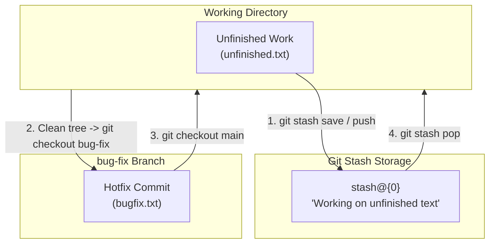

# College Lab Activity — Experiment 3
## Creating and Managing Branches (Stashing)


---

## 📋 Experiment Overview
- **Course**: Software Engineering & Version Control Lab
- **Experiment No**: 3
- **Title**: Creating and Managing Branches (Stashing)
- **Student**: Shreyas M H ([@shreyasMH26](https://github.com/shreyasMH26))
- **Objective**: Set up a new workspace for Lab 3, initialize a Git repository, create unfinished work, stash the uncommitted changes to achieve a clean working tree, switch to a different branch to perform another task, and return to apply the stashed changes.

---

## 🧠 Git Stash Architecture

Git Stash acts like a temporary clipboard for uncommitted code, allowing seamless context-switching between branches without creating messy partial commits.



---

## 🛠️ Step-by-Step Execution Log (Lab Manual Compliance)

### Step 1: Create and enter new folder for Lab 3
```bash
mkdir lab3
cd lab3
```

### Step 2: Initialize repository and make a base commit
```bash
git init
echo "Base project file" > project.txt
git add .
git commit -m "Initial commit"
```

### Step 3: Create a second branch (for later)
```bash
git branch bug-fix
```
*Creates the `bug-fix` pointer while keeping HEAD on `main`.*

### Step 4: Start messy work (Do NOT commit)
```bash
echo "Half-written code..." > unfinished.txt
git add .
```

### Step 5: Stash current changes
```bash
git stash save "Working on unfinished text"
```
*Clean working tree achieved; uncommitted changes safely archived.*

### Step 6: Switch to desired branch safely
```bash
git checkout bug-fix
```
*Switched to `bug-fix`. Resolved critical hotfix and committed.*

### Step 7: Switch back to original branch
```bash
git checkout main
```

### Step 8: Check saved stashes
```bash
git stash list
# Output: stash@{0}: On main: Working on unfinished text
```

### Step 9: Apply stashed changes
```bash
git stash pop
```
*Restored `unfinished.txt` into working directory and removed the entry from the stash stack.*

---

## 💡 Key Concept: `git stash pop` vs `git stash apply`

| Command | Action on Working Tree | Action on Stash Memory |
| :--- | :--- | :--- |
| `git stash pop` | Restores modifications | **Deletes** the stash entry from the stack |
| `git stash apply` | Restores modifications | **Retains** the backup entry in the stash stack |

---

## 🎨 Creative Enhancement: Interactive Stash Showcase

A dedicated Python tool `stash_demo.py` is included for live demonstrations:
- Visualizes the Stash temporary clipboard architecture.
- Real-time Git inspection of active branches and commit graphs.
- Includes an interactive `--quiz` mode for viva or lab assessment.

### How to run:
```bash
# Run visual showcase
python3 stash_demo.py

# Run interactive knowledge quiz
python3 stash_demo.py --quiz
```

---

## 🔍 Verification Commands for Evaluator / Mam

### 1. View Branches (Local and Remote):
```bash
git branch -a
```

### 2. View Commit Graph Across Branches:
```bash
git log --graph --oneline --all
```

---
*Submitted for evaluation — Lab 3 Activity Completed.*
